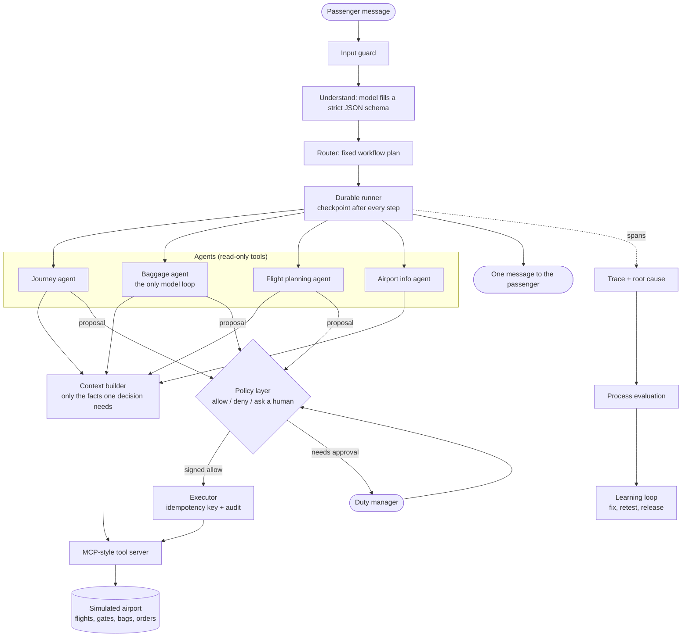

# Agentic AI system design, end to end

One working agentic AI system for a fictional airport, **Harrowgate International**, designed layer
by layer: from product requirements to a learning loop. Every one of the 14 design layers has its own
code, tests and a short page in plain English. Runs fully offline with a deterministic mock model.

## Recruiter summary

- **Problem:** passengers at a busy airport need help when things change: a gate moves, a bag goes to
  the wrong place, a duty-free order is waiting, or a flight is missed. A chatbot that guesses can send
  someone to the wrong gate or rebook them without permission.
- **Approach:** four small agents with clear boundaries, a fixed workflow, a context builder that
  refuses stale data, a policy layer that decides what agents may do, durable execution with
  checkpoints, sagas and idempotency keys, process-level evaluation, traces with root-cause labels,
  and a learning loop that fixes the most common failure first and only releases when nothing regresses.
- **Proof (measured on 129<!-- m:suite.scenarios --> synthetic scenarios, simulated airport):** the learning loop
  takes the early version from **69.0%**<!-- m:v0.success.rate --> to **95.3%**<!-- m:final.success.rate --> of scenarios passing every check,
  with 0<!-- m:final.duplicate_effects --> duplicate side effects (down from 9<!-- m:v0.duplicate_effects -->) and 0<!-- m:final.unauthorized_actions -->
  unauthorized actions. Context packets are 96.2%<!-- m:final.context.reduction --> smaller than sending
  everything. The 6 remaining failures are known limits, kept visible as tests. <!-- tests -->166<!-- /tests --> tests, CI green.

## Purpose and who it is for

- **AI engineers and architects** who want to see each design decision of an agentic system as code
  they can run and break, not as a slide.
- **Hiring teams** who want proof of system design depth: authority, recovery, evaluation and learning,
  not just prompts.
- **Teams starting their own agent** who can copy the layer pattern (see the
  [implementation guide](docs/implementation-guide.md)).

It is a reference build on synthetic data. It is not connected to any real airport, airline or shop.

## Architecture



## The 14 layers

| # | Layer | The design question | Harrowgate answer | Page |
|---|---|---|---|---|
| 1 | Product requirements | What must it achieve, never do, and who decides? | Typed spec: 5 outcomes, 5 boundaries, 7 limits, authority per tool | [01](docs/layers/01-requirements.md) |
| 2 | Orchestration | Who decides the order of work? | Fixed workflows picked by a router; gate change before duty-free | [02](docs/layers/02-orchestration.md) |
| 3 | Agent boundaries | How many agents, owning what? | 4 agents split by data and authority; maths stays as code | [03](docs/layers/03-agent-boundaries.md) |
| 4 | Context | What does each decision see? | Per-decision packets with source and age; stale data refetched | [04](docs/layers/04-context.md) |
| 5 | State and memory | What is remembered, where, for how long? | Knowledge, context, memory and journey state kept apart | [05](docs/layers/05-state-memory.md) |
| 6 | Knowledge | Which store answers which question? | Graph for linked questions, database for one fact, retrieval for policy | [06](docs/layers/06-knowledge.md) |
| 7 | Actions | How careful must each action be? | Read / write / commit, with validation, logging and idempotency | [07](docs/layers/07-actions.md) |
| 8 | Authority | Who may say yes? | Agent proposes; policy decides; executor runs only signed allows | [08](docs/layers/08-authority.md) |
| 9 | Interaction | Tool, code, retrieval or agent? | Cheapest reliable mechanism; MCP-style tools; typed agent handoffs | [09](docs/layers/09-interaction.md) |
| 10 | Runtime | What happens on timeouts and crashes? | Retries with backoff, budgets, cancel, checkpoints, resume | [10](docs/layers/10-runtime.md) |
| 11 | Recovery | How do we undo half-done work? | Sagas with compensation; keys stop double delivery | [11](docs/layers/11-recovery.md) |
| 12 | Evaluation | How do we know it worked? | 11 process checks per scenario, not just the final answer | [12](docs/layers/12-evaluation.md) |
| 13 | Observability | Why did it fail? | One trace per request; root cause named from the trace | [13](docs/layers/13-observability.md) |
| 14 | Learning | How does it get better safely? | Classify, fix the top pattern, retest, release only without regressions | [14](docs/layers/14-learning.md) |

## How it works, step by step

1. **Guard.** The input guard looks for text that tries to instruct the assistant ("ignore previous
   instructions"). It does not block; it marks the request so policy refuses bookings for it.
2. **Understand.** The model turns the message into intents and IDs using a strict JSON schema. A bad
   answer gets one repair try, then a human.
3. **Plan.** The router picks fixed workflows in a fixed priority order and removes repeated steps.
4. **Run.** The durable runner executes each step and saves a checkpoint after it.
5. **Context.** Each step asks the context builder for a small packet. Volatile data (gate, status)
   older than 5 minutes is fetched again.
6. **Decide.** Plain code works out routes, walking times and the time-to-boarding check. Only the
   lost-bag investigation is a model loop, capped at 6 steps.
7. **Act.** Agents only propose side effects. Policy answers allow, deny or needs-a-human. The
   executor runs allowed actions with an idempotency key and writes an audit record.
8. **Recover.** A rebooking is a saga: if the booking step fails, the held seat is released.
9. **Reply.** One message goes to the passenger. The trace, the evaluation and the learning loop use
   everything recorded on the way.

## Real code and real output

The end-to-end demo (`examples/demo.py`): a gate change, a duty-free order and a bag, with a cached
copy of the flight that is 15 minutes old.

<!-- run: python examples/demo.py -->
```text
Clock 08:40 | passenger P-1001 at the central plaza | flight SK204
Request : My gate changed and I still want to pick up my duty-free order. Will my bag make it?
Intents : gate_change, duty_free
Plan    : journey.refresh_flight -> journey.route_to_gate -> baggage.check_bags -> journey.check_timing -> flight_planning.find_alternatives -> flight_planning.rebook -> journey.plan_duty_free -> journey.act_duty_free -> journey.notify
Context : flight data from live (cached copy was 15 min old, limit 5) | 55 tokens instead of 1530
Route   : PLAZA > DF-CENTRAL > PLAZA > TRAIN-PLAZA > TRAIN-C > PIER-C > C1 > C2 > C3 > C4 | ETA 09:02 | boarding closes 09:45
Policy  : reroute_bag=allow (R4-confirm-and-log); send_notification=allow (R4-confirm-and-log)
Effects : bag_reroute; notification
Message :
  - Your gate is now C4 for SK204. About 16 min from you; boarding closes 09:45.
  - Your bag BG-5001 is being moved to the new gate's loading area.
  - Collect order DF-9001 at Plaza duty-free, then go to gate C4 (about 22 min in total).
Checks  : 11/11 passed | tool calls 6 | tokens 108 | simulated latency 1296 ms
Same request on v0 (no freshness check): sent to B4 -> root cause stale_context
```
<!-- /run -->

The two rebooking steps in the plan are guarded: they only act if the timing check hands off to the
flight planning agent.

The policy layer is plain code that never trusts numbers from the agent
([`harrowgate/policy.py`](harrowgate/policy.py)):

```python
if p.tool == "rebook_passenger":
    f = self.facts("rebook", p.arguments)          # fares and seats from the system of record
    if f["cabin_change"]:
        return self._out(p, Verdict.DENY, "R5-cabin", "cabin changes are not offered by the assistant")
    if f["seats_free"] <= 0 and not f["seat_held"]:
        return self._out(p, Verdict.DENY, "R5-no-seat", "no seat on the target flight")
    if f["fare_diff"] == 0:
        return self._out(p, Verdict.ALLOW, "R6-same-fare", "same destination, no fare difference")
    return self._out(p, Verdict.NEEDS_APPROVAL, "R7-fare-diff", ...)
```

A missed flight, three human answers, and a booking system outage (`examples/rebook_approval.py`):

<!-- run: python examples/rebook_approval.py -->
```text
human=approve status=done             policy=['rebook_passenger:needs_approval', 'rebook_passenger:allow', 'hold_seat:allow', 'send_notification:allow']
  effects=['seat_hold', 'rebooking', 'notification']
human=deny    status=denied           policy=['rebook_passenger:needs_approval', 'rebook_passenger:deny', 'send_notification:allow']
  effects=['notification']
human=None    status=pending_approval policy=['rebook_passenger:needs_approval', 'send_notification:allow']
  effects=['notification']
booking system down -> status=escalated; saga={'status': 'compensated', 'compensated': ['hold_seat'], 'failed_step': 'rebook_passenger'}
  effects=['seat_hold', 'seat_release', 'notification']
```
<!-- /run -->

A crash right after the message was sent, then a resume from the checkpoint (`examples/crash_resume.py`):

<!-- run: python examples/crash_resume.py -->
```text
[v0] crashed after step journey.notify
[v0] resumed -> status done; messages delivered: 2; replayed by key: 0
[v3] crashed after step journey.notify
[v3] resumed -> status done; messages delivered: 1; replayed by key: 1
```
<!-- /run -->

## Results (synthetic scenarios, simulated airport)

All numbers come from `python scripts/run_eval.py`; CI re-runs it and fails if any number here drifts.
The suite is 129<!-- m:suite.scenarios --> self-written scenarios in 29<!-- m:suite.families --> families: a regression
suite, not a benchmark. Latency is the sum of declared tool latencies and cost uses an assumed token
price, so both are **simulated**. Full table: [results/eval_report.md](results/eval_report.md).

| Version | What the learning loop changed | Scenarios passing |
|---|---|---|
| v0 | early version: no freshness check, no boarding guard, no idempotency keys | 69.0%<!-- m:learning.0.success --> |
| v1 | context refuses flight data older than 5 minutes (fixes stale context) | 78.3%<!-- m:learning.1.success --> |
| v2 | time-to-boarding check before any duty-free detour (fixes unsafe timing) | 88.4%<!-- m:learning.2.success --> |
| v3 | idempotency keys on every write (fixes duplicate side effects) | 95.3%<!-- m:learning.3.success --> |

Final version (v3), per request:

- Right gate: 96.9%<!-- m:final.checks.location -->; valid routes: 100.0%<!-- m:final.checks.route -->; safe timing: 100.0%<!-- m:final.checks.timing -->
- Duplicate side effects: 0<!-- m:final.duplicate_effects -->; unauthorized actions: 0<!-- m:final.unauthorized_actions -->; access violations: none (access check 100.0%<!-- m:final.checks.access -->)
- Average tool calls: 4.89<!-- m:final.avg_tool_calls -->; average model tokens: 162.8<!-- m:final.avg_tokens -->
- Simulated latency p50 1128<!-- m:final.sim_latency_ms.p50 --> ms, p95 3552<!-- m:final.sim_latency_ms.p95 --> ms; simulated cost
  $0.000326<!-- m:final.sim_cost_usd_per_request --> per request at an assumed $0.002 per 1K tokens
- Context packet 57.9<!-- m:final.context.avg_packet_tokens --> tokens on average instead of 1530<!-- m:final.context.avg_raw_tokens -->
- Knowledge store choice right on 21<!-- m:knowledge.store_choice.correct --> of 22<!-- m:knowledge.store_choice.n --> labelled questions;
  FAQ retrieval hit@1 on 17<!-- m:knowledge.faq_hit_at_1.correct --> of 18<!-- m:knowledge.faq_hit_at_1.n -->

## How to run

Offline, no keys, Python 3.11+ and nothing else (the package uses only the standard library):

```bash
git clone https://github.com/jagadishmazure-jpg/Jagadish-agentic-system-design
cd Jagadish-agentic-system-design
pip install -r requirements.txt          # pytest + ruff only
python -m pytest -q                      # all tests
python examples/demo.py                  # the end-to-end story
python scripts/run_eval.py               # full evaluation + learning loop -> results/
python -m harrowgate ask P-1002 "Which gate is BF117?" --trace
python -m harrowgate serve --port 8080   # HTTP: POST /v1/assist
```

Optional real model (written, not run here): set `HARROWGATE_LLM=foundry`, `FOUNDRY_ENDPOINT`,
`FOUNDRY_DEPLOYMENT` and an Entra ID token in `AZURE_ACCESS_TOKEN`. The same schema checks and repair
logic apply. Azure hosting is described in [docs/deployment.md](docs/deployment.md) and is gated off.

## Guardrails and security controls

- Agents hold **read-only** tools. Only the executor can call write tools, and the tool server refuses
  any write without a policy-signed token bound to that exact call.
- **Policy reads its own facts** (fares, seats) and never trusts numbers from the agent.
- **Human approval** for any fare difference; refunds are out of scope entirely.
- **Prompt-injection** text marks the request untrusted; bookings and seat holds are then denied.
- **Idempotency keys** on every write; **sagas** undo half-done rebookings.
- **Budgets**: 25 tool calls, 6,000 tokens, 8 s simulated latency, 6 investigation steps per request.
- **Privacy**: traces mask names and emails and replace passenger IDs with keyed pseudonyms; one
  passenger can never read another passenger's order.
- Full threat model: [docs/threat-model.md](docs/threat-model.md).

## Limitations and known failures

These stay in the suite as failing scenarios on purpose (see `tests/test_l12_evaluation.py`):

- **Gate change inside the 5-minute window (4 scenarios).** A time-based freshness rule cannot see a
  change that happened 1 minute after a 3-minute-old copy. The fix is event-driven cache invalidation
  (Planned).
- **"How do I report a delayed bag?"** The keyword parser reads "delayed" as a flight-status question.
- **"How do I connect to the wifi?"** The retriever splits "Wi-Fi" into "wi" and "fi".
- **Store choice:** "Is my plane leaving on time?" goes to retrieval, because "plane" is not in the
  entity word list.
- The mock model is keyword based. A real model would parse more phrasings but adds cost and variance;
  the schema checks are the same either way.
- The airport, schedule and timings are small and simulated; numbers show the design works on this
  suite, not how a real airport would score.

## Built vs planned

| Item | Status |
|---|---|
| 14 layers with code, tests and a doc page | Built |
| Deterministic mock model, schema validation, repair, escalation | Built |
| MCP-style tool server (JSON-RPC `tools/list`, `tools/call`) and typed agent handoffs | Built |
| Durable runner (SQLite checkpoints), retries, budgets, cancel, resume | Built |
| Sagas, idempotency keys, process evaluation, traces, learning loop | Built |
| HTTP API and Dockerfile (image built and smoke-tested in CI, not pushed) | Built |
| Microsoft Foundry model adapter (`HARROWGATE_LLM=foundry`) | Written, not run |
| Terraform + Bicep for Container Apps + Microsoft Foundry, gated deploy workflow | Written, not run |
| Event-driven cache invalidation for gate changes | Planned |
| Durable state in a managed database instead of container-local SQLite | Planned |
| Private endpoints and VNet integration | Planned |
| Real-time trace export to Application Insights (OpenTelemetry) | Planned |

## Documentation

- Layer pages: [docs/layers/](docs/layers/)
- [Implementation guide](docs/implementation-guide.md) - how to build your own agent this way
- [Interview points](docs/interview-points.md) - questions and answers per layer
- [Threat model](docs/threat-model.md) - STRIDE and OWASP LLM Top 10
- [Deployment](docs/deployment.md) - Azure resources, cost drivers, how to run the gated deploy
- [Architecture decisions](docs/adr/)
- [Evaluation report](results/eval_report.md)

## Related repos

- [Jagadish-ai-system-design-at-scale](https://github.com/jagadishmazure-jpg/Jagadish-ai-system-design-at-scale) - scale patterns (gateway, cache, queues, SLOs) around one agent; this repo is about the agent's own design layers
- [Jagadish-agent-eval-studio](https://github.com/jagadishmazure-jpg/Jagadish-agent-eval-studio) - deeper trajectory metrics and anti-gaming checks
- [Jagadish-azure-ai-integration-platform](https://github.com/jagadishmazure-jpg/Jagadish-azure-ai-integration-platform) - production MCP / A2A gateways with OBO and idempotency
- [Jagadish-agent-auth-security](https://github.com/jagadishmazure-jpg/Jagadish-agent-auth-security) - authentication for users and agents in depth
- [Jagadish-agentic-data-layer](https://github.com/jagadishmazure-jpg/Jagadish-agentic-data-layer) - governed data products and GraphRAG for agents
- [Jagadish-agent-tuning-loops](https://github.com/jagadishmazure-jpg/Jagadish-agent-tuning-loops) - config-driven tuning loops for multi-agent systems

## License

MIT - see [LICENSE](LICENSE).
