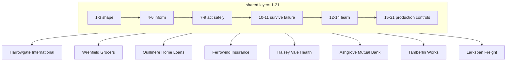

<!-- Generated by scripts/run_packs.py from results/packs.json. Do not edit by hand; CI fails if this file differs from a fresh run. -->

# What each layer improves, per domain

Each cell is measured on that domain's synthetic suite. "off" means the full system with only that layer switched off; pp = change in the share of scenarios passing every check. Layers 19 and 20 are measured with their own simulations (release gate on the same suites; a load simulation with one bursting tenant). The airport column is the airport services pack; the flagship airport assistant has its own results in `results/metrics.json`.

| Layer | What it does | airport | retail | mortgage | insurance | healthcare | banking | IT service desk | logistics |
| --- | --- | --- | --- | --- | --- | --- | --- | --- | --- |
| 1. Requirements | turns goals into limits the code enforces | limits held 35/35 | limits held 35/35 | limits held 35/35 | limits held 35/35 | limits held 35/35 | limits held 35/35 | limits held 35/35 | limits held 35/35 |
| 2. Orchestration | sends each request down a fixed workflow | right workflow 35/35 | right workflow 35/35 | right workflow 35/35 | right workflow 35/35 | right workflow 35/35 | right workflow 35/35 | right workflow 35/35 | right workflow 35/35 |
| 3. Agent boundaries | keeps write tools away from the reasoning step | writes visible to agent: 0 of 6 | writes visible to agent: 0 of 7 | writes visible to agent: 0 of 7 | writes visible to agent: 0 of 7 | writes visible to agent: 0 of 6 | writes visible to agent: 0 of 6 | writes visible to agent: 0 of 6 | writes visible to agent: 0 of 6 |
| 4. Context | sends only what the decision needs | packet 41.9 vs 467 tokens | packet 46.3 vs 507 tokens | packet 47 vs 671 tokens | packet 44.8 vs 509 tokens | packet 46.7 vs 580.8 tokens | packet 38.9 vs 422.1 tokens | packet 42.1 vs 474 tokens | packet 40.1 vs 447 tokens |
| 5. State and memory | checkpoints every step so a crash resumes | off: -5.7 pp, lost progress 2 | off: -5.7 pp, lost progress 2 | off: -5.7 pp, lost progress 2 | off: -5.7 pp, lost progress 2 | off: -5.7 pp, lost progress 2 | off: -5.7 pp, lost progress 2 | off: -5.7 pp, lost progress 2 | off: -5.7 pp, lost progress 2 |
| 6. Knowledge | answers policy questions from written sources | answers right 6/6 | answers right 6/6 | answers right 6/6 | answers right 6/6 | answers right 6/6 | answers right 6/6 | answers right 6/6 | answers right 6/6 |
| 7. Action design | uses rule code before any model call | off: tokens 120.7 -> 175.5 | off: tokens 119.8 -> 175.7 | off: tokens 121.4 -> 177.4 | off: tokens 118.7 -> 175.1 | off: tokens 120.7 -> 176.2 | off: tokens 140.1 -> 194.3 | off: tokens 117.7 -> 172.5 | off: tokens 118.1 -> 173.3 |
| 8. Authority | decides writes outside the agent | off: -5.7 pp, unauthorized 3 (e.g. refund over the limit) | off: -5.7 pp, unauthorized 3 (e.g. refund over the limit) | off: -5.7 pp, unauthorized 3 (e.g. lock extended over the limit) | off: -5.7 pp, unauthorized 3 (e.g. payout over the limit) | off: -5.7 pp, unauthorized 3 (e.g. transport over the limit) | off: -5.7 pp, unauthorized 3 (e.g. provisional credit over the limit) | off: -5.7 pp, unauthorized 3 (e.g. access granted over the limit) | off: -5.7 pp, unauthorized 3 (e.g. credit over the limit) |
| 9. Tool protocol | idempotency keys on every write | off: -11.4 pp, duplicates 6 (e.g. a second refund) | off: -11.4 pp, duplicates 6 (e.g. a second refund) | off: -11.4 pp, duplicates 6 (e.g. a second lock extended) | off: -11.4 pp, duplicates 6 (e.g. a second payout) | off: -11.4 pp, duplicates 6 (e.g. a second transport) | off: -11.4 pp, duplicates 6 (e.g. a second provisional credit) | off: -11.4 pp, duplicates 6 (e.g. a second access granted) | off: -11.4 pp, duplicates 6 (e.g. a second credit) |
| 10. Durable runtime | retries, budgets and resume | lost reply + crash: 4/4 pass | lost reply + crash: 4/4 pass | lost reply + crash: 4/4 pass | lost reply + crash: 4/4 pass | lost reply + crash: 4/4 pass | lost reply + crash: 4/4 pass | lost reply + crash: 4/4 pass | lost reply + crash: 4/4 pass |
| 11. Recovery (sagas) | undoes finished steps when a later one fails | off: -2.9 pp, half-done 1 (e.g. service cancelled left without refund) | off: -2.9 pp, half-done 1 (e.g. return label left without refund) | off: -2.9 pp, half-done 1 (e.g. lock fee left without lock extended) | off: -2.9 pp, half-done 1 (e.g. payout left without claim closed) | off: -2.9 pp, half-done 1 (e.g. transport left without ward notice) | off: -2.9 pp, half-done 1 (e.g. dispute opened left without provisional credit) | off: -2.9 pp, half-done 1 (e.g. access granted left without ticket closed) | off: -2.9 pp, half-done 1 (e.g. rescheduled left without credit) |
| 12. Evaluation | judges the process, not the sentence | 10 checks x 35 scenarios | 10 checks x 35 scenarios | 10 checks x 35 scenarios | 10 checks x 35 scenarios | 10 checks x 35 scenarios | 10 checks x 35 scenarios | 10 checks x 35 scenarios | 10 checks x 35 scenarios |
| 13. Observability | traces name the root cause | v0 failures with a fixable cause: 100.0% | v0 failures with a fixable cause: 100.0% | v0 failures with a fixable cause: 100.0% | v0 failures with a fixable cause: 100.0% | v0 failures with a fixable cause: 100.0% | v0 failures with a fixable cause: 100.0% | v0 failures with a fixable cause: 100.0% | v0 failures with a fixable cause: 100.0% |
| 14. Learning loop | fixes the most common cause, retests, releases | 17.1% -> 97.1% | 17.1% -> 97.1% | 17.1% -> 97.1% | 17.1% -> 97.1% | 17.1% -> 97.1% | 17.1% -> 97.1% | 17.1% -> 97.1% | 17.1% -> 97.1% |
| 15. Security | blocks injected text, poisoned tools and exfiltration | off: -5.7 pp, attacks followed 2 | off: -5.7 pp, attacks followed 2 | off: -5.7 pp, attacks followed 2 | off: -5.7 pp, attacks followed 2 | off: -5.7 pp, attacks followed 2 | off: -5.7 pp, attacks followed 2 | off: -5.7 pp, attacks followed 2 | off: -5.7 pp, attacks followed 2 |
| 16. Identity and access | acts only for the signed-in person | off: -5.7 pp, reads of another passenger's booking 2 | off: -5.7 pp, reads of another customer's order 2 | off: -5.7 pp, reads of another applicant's application 2 | off: -5.7 pp, reads of another policyholder's claim 2 | off: -5.7 pp, reads of another patient's hospital stay 2 | off: -5.7 pp, reads of another customer's transaction 2 | off: -5.7 pp, reads of another employee's access request 2 | off: -5.7 pp, reads of another customer's shipment 2 |
| 17. Cost and model routing | small model for easy work | off: cost x2.50 | off: cost x1.75 | off: cost x2.50 | off: cost x3.12 | off: cost x3.16 | off: cost x1.87 | off: cost x3.12 | off: cost x3.11 |
| 18. Caching and freshness | change events evict stale cache entries | events off: stale answers 2 | events off: stale answers 2 | events off: stale answers 2 | events off: stale answers 2 | events off: stale answers 2 | events off: stale answers 2 | events off: stale answers 2 | events off: stale answers 2 |
| 19. Versioning and release | canary gate and automatic rollback | good promoted, bad rolled back | good promoted, bad rolled back | good promoted, bad rolled back | good promoted, bad rolled back | good promoted, bad rolled back | good promoted, bad rolled back | good promoted, bad rolled back | good promoted, bad rolled back |
| 20. Multi-tenancy and backpressure | fair share and load shedding per tenant | served 100.0% fair vs 50.0% unfair | served 9.2% fair vs 46.2% unfair | served 100.0% fair vs 50.0% unfair | served 100.0% fair vs 55.0% unfair | served 100.0% fair vs 58.3% unfair | served 100.0% fair vs 55.0% unfair | served 100.0% fair vs 50.0% unfair | served 100.0% fair vs 55.0% unfair |
| 21. Governance and audit | masks PII, removes protected fields, audits | off: PII leaks 36, protected fields seen 27 | off: PII leaks 36, protected fields seen 27 | off: PII leaks 36, protected fields seen 135 | off: PII leaks 36, protected fields seen 54 | off: PII leaks 36, protected fields seen 54 | off: PII leaks 36, protected fields seen 27 | off: PII leaks 36, protected fields seen 27 | off: PII leaks 36, protected fields seen 27 |

## Reading the matrix

- The same layer protects every domain in the same way because the scenario families are the same; what differs is what the failure costs (a duplicate refund, a double payout, a second rate-lock fee, a transport booked twice).
- Layers 4 and 7 show their value in tokens rather than pass rate: with templates and rule code on, no model reads the context, so trimming matters most when a model does (see the optimisation page).
- Freshness has two parts: the time limit (layer 4) and change events (layer 18). With events on, the time limit alone adds nothing on these suites; with events off, changes inside the time window are missed.
