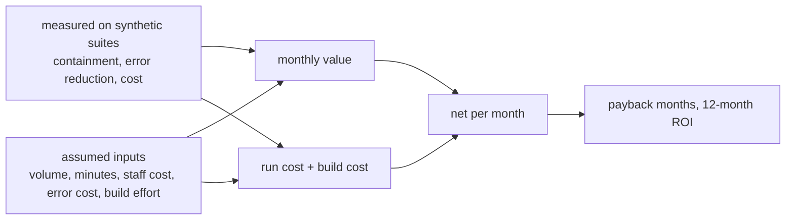

<!-- Generated by scripts/run_packs.py from results/packs.json. Do not edit by hand; CI fails if this file differs from a fresh run. -->

# Business case: KPIs, ROI and payback (illustrative)

**Read this first.** Business inputs below are assumptions for fictional organisations, chosen to be plausible for planning, and labelled as such. Rates such as containment and error reduction are measured on self-written synthetic suites that over-represent failures on purpose. Nothing here is a client result or a forecast. Replace every assumption with real figures before using it.

## KPIs the system moves

| Domain | Main KPI | How the layers move it |
| --- | --- | --- |
| airport | service-refund handling time | routine refunds finish in one step; duplicates and refunds to the wrong passenger are blocked |
| retail | refund handling time | refunds within the rules finish without a person; double refunds and refund fraud are blocked |
| mortgage | rate-lock extension turnaround | extensions inside the schedule finish at once; protected attributes never reach the decision |
| insurance | small-claim cycle time | small clean claims pay out in one step; double payouts and oversized payouts are blocked |
| healthcare | discharge-to-transport wait | transport is booked as soon as the discharge order is signed; no diagnoses in messages |
| banking | dispute intake and provisional-credit time | disputes open and small temporary credits post at once; card numbers never leave |
| IT service desk | access-request resolution time | standard access is granted at once; admin groups always need the system owner |
| logistics | delivery-exception resolution time | missed slots are rebooked and credited at once; dangerous goods go to the compliance desk |

## Assumptions (all ASSUMED)

| Domain | Requests / month | Manual min | Assisted min | Review min | Staff USD/h | Rework rate | Rework USD | Platform USD/month | Build weeks |
| --- | --- | --- | --- | --- | --- | --- | --- | --- | --- |
| airport | 9,000 | 7 | 1.0 | 9 | 38 | 4% | 30 | 900 | 10 |
| retail | 20,000 | 6 | 0.8 | 8 | 32 | 5% | 25 | 900 | 10 |
| mortgage | 2,500 | 20 | 3.0 | 25 | 55 | 3% | 400 | 1,100 | 14 |
| insurance | 6,000 | 25 | 4.0 | 30 | 48 | 4% | 350 | 1,100 | 14 |
| healthcare | 3,000 | 15 | 2.0 | 15 | 45 | 3% | 120 | 1,200 | 16 |
| banking | 8,000 | 18 | 2.5 | 20 | 50 | 3% | 90 | 1,100 | 14 |
| IT service desk | 7,000 | 12 | 1.5 | 12 | 45 | 4% | 60 | 800 | 8 |
| logistics | 12,000 | 8 | 1.0 | 10 | 35 | 5% | 40 | 900 | 10 |

Engineering week cost (assumed): USD 4,000. Traffic mix per domain is assumed (see `harrowgate/roi.py`); the contained rate of each kind of request is measured.

## Results: low / base / high

Low: half the volume, 70% of the minutes saved, 80% of the containment, half the rework avoided. High: 1.5x volume, 1.2x minutes, 1.05x containment, 1.5x rework avoided.

| Domain | Containment (mix x measured) | Error reduction (measured) | Net USD / month low / base / high | Payback months low / base / high | 12-month ROI base |
| --- | --- | --- | --- | --- | --- |
| airport | 93.5% | 96.5% | 9,229 / 40,780 / 82,717 | 4.3 / 1.0 / 0.5 | 11.23x |
| retail | 92.8% | 96.5% | 16,790 / 73,148 / 149,827 | 2.4 / 0.5 / 0.3 | 20.94x |
| mortgage | 88.9% | 96.5% | 14,187 / 61,237 / 128,403 | 3.9 / 0.9 / 0.4 | 12.12x |
| insurance | 88.9% | 96.5% | 40,808 / 166,974 / 348,394 | 1.4 / 0.3 / 0.2 | 34.78x |
| healthcare | 91.5% | 96.5% | 8,900 / 35,988 / 72,839 | 7.2 / 1.8 / 0.9 | 5.75x |
| banking | 89.5% | 96.5% | 28,129 / 110,883 / 219,496 | 2.0 / 0.5 / 0.3 | 22.76x |
| IT service desk | 89.8% | 96.5% | 17,118 / 64,933 / 129,275 | 1.9 / 0.5 / 0.2 | 23.35x |
| logistics | 92.8% | 96.5% | 15,816 / 66,716 / 136,605 | 2.5 / 0.6 / 0.3 | 19.01x |

## Per-layer business view (synthetic suites)

Incidents prevented by each safety layer, per domain suite of 35 scenarios (what happens with only that layer off). The suites contain attacks and faults on purpose, so these are not production rates.

| Domain | Duplicate writes (layer 9) | Unauthorized writes (layer 8) | Cross-customer reads (16) | PII leaks (21) | Attacks followed (15) |
| --- | --- | --- | --- | --- | --- |
| airport | 6 | 3 | 2 | 36 | 2 |
| retail | 6 | 3 | 2 | 36 | 2 |
| mortgage | 6 | 3 | 2 | 36 | 2 |
| insurance | 6 | 3 | 2 | 36 | 2 |
| healthcare | 6 | 3 | 2 | 36 | 2 |
| banking | 6 | 3 | 2 | 36 | 2 |
| IT service desk | 6 | 3 | 2 | 36 | 2 |
| logistics | 6 | 3 | 2 | 36 | 2 |

## Advantage and risk reduction, in plain words

- **Speed where it is safe, people where it matters.** Routine requests inside the rules finish at once; anything above a limit or outside a rule goes to a named role with a short hand-off note.
- **Fewer expensive mistakes.** Duplicate refunds, double payouts and changes on someone else's record are stopped by code, not by asking the model to be careful.
- **Auditable by design.** Every decision has a rule id, the facts used, the approver and a hash-chained log entry, which shortens audits and complaint handling.
- **Cost that falls as volume grows.** Rule code, templates and a small model for easy work keep the model bill small; see the optimisation page.
- **Portable.** The core runs the same on Azure (primary), AWS, Google Cloud or self-hosted open models; see the hosting options page.
