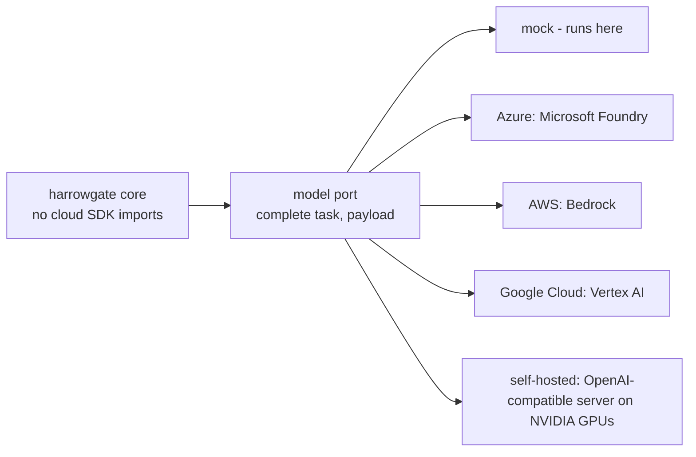

<!-- Generated by scripts/run_packs.py from results/packs.json. Do not edit by hand; CI fails if this file differs from a fresh run. -->

# Hosting options and cost comparison

**All prices are estimates assumed on 2026-11-09**: round, list-price-style figures, not quotes. Check current provider pricing before using them. Managed token prices are set equal across clouds on purpose, so the table isolates hosting and operating differences.

| Option | Runtime | Model access | Fixed per month (USD) | Ops hours / month |
| --- | --- | --- | --- | --- |
| Azure | Container Apps (1 always-on replica) | Microsoft Foundry model deployment | 85 | 2.0 |
| AWS | ECS on Fargate (1 task) + load balancer | managed model endpoint (Bedrock) | 80 | 2.0 |
| Google Cloud | Cloud Run (1 minimum instance) | managed model endpoint (Vertex AI) | 70 | 2.0 |
| Self-hosted | 2 small NVIDIA GPU servers (24 GB each), open 8B model | OpenAI-compatible server (for example vLLM) | 660 | 10.0 |

Tokens per request (measured average over all domain suites, all layers on): 87.6 small-tier and 34.5 large-tier tokens.

| Requests / month | Azure | AWS | Google Cloud | Self-hosted |
| --- | --- | --- | --- | --- |
| 10,000 | 266 | 261 | 251 | 1,560 |
| 100,000 | 278 | 273 | 263 | 1,560 |
| 1,000,000 | 395 | 390 | 380 | 1,560 |

How to read it:

- At these token counts the model bill is small next to fixed hosting and people time, because rule code and templates replace most model calls. Managed options win at low and medium volume.
- Self-hosting has no per-token cost but carries hardware (amortised over 36 months), power and more ops time; it pays off only at high, steady volume or when data must stay on site.
- The self-hosted capacity figure (requests per second for a small open model) is an estimate; size it with a load test before buying hardware.

Deployment templates (written, validated, not run; switched off by default): `infra/terraform` and `infra/bicep` (Azure), `infra/aws`, `infra/gcp`, `infra/onprem`. See `docs/adr/0010-cloud-neutral-core.md`.
