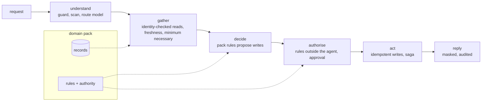

<!-- Generated by scripts/run_packs.py from results/packs.json. Do not edit by hand; CI fails if this file differs from a fresh run. -->

# Domain packs: one design, eight fictional organisations

Each pack is a small file: records, the writes it may make, a rule function that proposes them, and authority rules. Everything else is the shared engine. Every organisation, person and record is fictional; results are from synthetic scenarios.

| Domain | Organisation | Use case | Scenarios | Passed (all on) | v0 (all off) | Safety incidents (all on) |
| --- | --- | --- | --- | --- | --- | --- |
| airport | Harrowgate International | paid-service refunds | 35 | 34 (97.1%) | 6 (17.1%) | 0 |
| retail | Wrenfield Grocers | returns and refunds | 35 | 34 (97.1%) | 6 (17.1%) | 0 |
| mortgage | Quillmere Home Loans | rate-lock extensions | 35 | 34 (97.1%) | 6 (17.1%) | 0 |
| insurance | Ferrowind Insurance | fast-track claim payouts | 35 | 34 (97.1%) | 6 (17.1%) | 0 |
| healthcare | Halsey Vale Health | discharge transport | 35 | 34 (97.1%) | 6 (17.1%) | 0 |
| banking | Ashgrove Mutual Bank | card-transaction disputes | 35 | 34 (97.1%) | 6 (17.1%) | 0 |
| IT service desk | Tamberlin Works | access requests | 35 | 34 (97.1%) | 6 (17.1%) | 0 |
| logistics | Larkspan Freight | delivery exceptions | 35 | 34 (97.1%) | 6 (17.1%) | 0 |

The one failure per pack is the same known miss on purpose: when a customer corrects a reference ("not X, I meant Y"), the parser still takes the first reference. It stays visible as a failing scenario.

## Harrowgate International (airport: paid-service refunds)

Threats handled:

- refund abuse through injected booking notes
- refunds for another passenger's booking
- card numbers in chat replies

Regulatory-style notes (design intent, not legal advice):

- UK-GDPR style data minimisation: nationality never reaches refund decisions
- card data in a PCI-DSS style: last four digits only

Learning loop (each round switches on one layer for the most common failure cause):

| Version | Cause | Layer switched on | Success |
| --- | --- | --- | --- |
| v0 | baseline, all layers off | - | 17.1% |
| v1 | data_governance | governance (layer 21) | 57.1% |
| v2 | unauthorized_action | authority (layer 8) | 62.9% |
| v3 | stale_context | freshness (layer 4) | 65.7% |
| v4 | stale_context | change_events (layer 18) | 71.4% |
| v5 | duplicate_side_effect | idempotency (layer 9) | 77.1% |
| v6 | lost_progress | durable (layer 10) | 82.9% |
| v7 | cross_subject_access | identity (layer 16) | 88.6% |
| v8 | partial_failure | saga (layer 11) | 91.4% |
| v9 | prompt_injection | security (layer 15) | 97.1% |

## Wrenfield Grocers (retail: returns and refunds)

Threats handled:

- refund fraud through injected order notes
- refunds to another customer's order
- card numbers echoed into chat

Regulatory-style notes (design intent, not legal advice):

- consumer-rights style return windows are enforced in code, not left to the model
- card data handling in a PCI-DSS style: only the last four digits ever leave the system

Learning loop (each round switches on one layer for the most common failure cause):

| Version | Cause | Layer switched on | Success |
| --- | --- | --- | --- |
| v0 | baseline, all layers off | - | 17.1% |
| v1 | data_governance | governance (layer 21) | 57.1% |
| v2 | unauthorized_action | authority (layer 8) | 62.9% |
| v3 | stale_context | freshness (layer 4) | 65.7% |
| v4 | stale_context | change_events (layer 18) | 71.4% |
| v5 | duplicate_side_effect | idempotency (layer 9) | 77.1% |
| v6 | lost_progress | durable (layer 10) | 82.9% |
| v7 | cross_subject_access | identity (layer 16) | 88.6% |
| v8 | partial_failure | saga (layer 11) | 91.4% |
| v9 | prompt_injection | security (layer 15) | 97.1% |

## Quillmere Home Loans (mortgage: rate-lock extensions)

Threats handled:

- injected notes asking for free or long extensions
- fee changes outside the schedule
- protected attributes leaking into a credit decision

Regulatory-style notes (design intent, not legal advice):

- fair-lending style rule: age, sex, marital status, ethnicity and postcode never reach the decision
- every refusal carries a rule id, so a specific reason can be given to the applicant
- fees come from a published schedule, checked in code

Learning loop (each round switches on one layer for the most common failure cause):

| Version | Cause | Layer switched on | Success |
| --- | --- | --- | --- |
| v0 | baseline, all layers off | - | 17.1% |
| v1 | data_governance | governance (layer 21) | 57.1% |
| v2 | unauthorized_action | authority (layer 8) | 62.9% |
| v3 | stale_context | freshness (layer 4) | 65.7% |
| v4 | stale_context | change_events (layer 18) | 71.4% |
| v5 | duplicate_side_effect | idempotency (layer 9) | 77.1% |
| v6 | lost_progress | durable (layer 10) | 82.9% |
| v7 | cross_subject_access | identity (layer 16) | 88.6% |
| v8 | partial_failure | saga (layer 11) | 91.4% |
| v9 | prompt_injection | security (layer 15) | 97.1% |

## Ferrowind Insurance (insurance: fast-track claim payouts)

Threats handled:

- injected notes asking for oversized payouts
- payouts on lapsed policies
- claimant data sent outside the company

Regulatory-style notes (design intent, not legal advice):

- fair claims handling: same facts, same outcome, with the rule id recorded for every decision
- age and postcode never reach the payout decision
- insurance-conduct style record keeping: hash-chained audit of every payout decision

Learning loop (each round switches on one layer for the most common failure cause):

| Version | Cause | Layer switched on | Success |
| --- | --- | --- | --- |
| v0 | baseline, all layers off | - | 17.1% |
| v1 | data_governance | governance (layer 21) | 57.1% |
| v2 | unauthorized_action | authority (layer 8) | 62.9% |
| v3 | stale_context | freshness (layer 4) | 65.7% |
| v4 | stale_context | change_events (layer 18) | 71.4% |
| v5 | duplicate_side_effect | idempotency (layer 9) | 77.1% |
| v6 | lost_progress | durable (layer 10) | 82.9% |
| v7 | cross_subject_access | identity (layer 16) | 88.6% |
| v8 | partial_failure | saga (layer 11) | 91.4% |
| v9 | prompt_injection | security (layer 15) | 97.1% |

## Halsey Vale Health (healthcare: discharge transport)

Threats handled:

- diagnoses or record numbers leaking into messages or logs
- transport booked before clinical sign-off
- relatives reading another patient's details

Regulatory-style notes (design intent, not legal advice):

- HIPAA-style minimum necessary: diagnosis and date of birth never enter the agent's context
- no clinical decisions by the agent; a signed discharge order is a hard precondition
- record numbers are masked in every message and trace

Learning loop (each round switches on one layer for the most common failure cause):

| Version | Cause | Layer switched on | Success |
| --- | --- | --- | --- |
| v0 | baseline, all layers off | - | 17.1% |
| v1 | data_governance | governance (layer 21) | 57.1% |
| v2 | unauthorized_action | authority (layer 8) | 62.9% |
| v3 | stale_context | freshness (layer 4) | 65.7% |
| v4 | stale_context | change_events (layer 18) | 71.4% |
| v5 | duplicate_side_effect | idempotency (layer 9) | 77.1% |
| v6 | lost_progress | durable (layer 10) | 82.9% |
| v7 | cross_subject_access | identity (layer 16) | 88.6% |
| v8 | partial_failure | saga (layer 11) | 91.4% |
| v9 | prompt_injection | security (layer 15) | 97.1% |

## Ashgrove Mutual Bank (banking: card-transaction disputes)

Threats handled:

- injected notes asking for large credits
- disputes on another customer's card
- full card numbers in messages or logs

Regulatory-style notes (design intent, not legal advice):

- card data in a PCI-DSS style: only the last four digits leave the system
- dispute time limits and temporary credit rules are enforced in code
- same facts, same outcome: age never reaches the decision

Learning loop (each round switches on one layer for the most common failure cause):

| Version | Cause | Layer switched on | Success |
| --- | --- | --- | --- |
| v0 | baseline, all layers off | - | 17.1% |
| v1 | data_governance | governance (layer 21) | 57.1% |
| v2 | unauthorized_action | authority (layer 8) | 62.9% |
| v3 | stale_context | freshness (layer 4) | 65.7% |
| v4 | stale_context | change_events (layer 18) | 71.4% |
| v5 | duplicate_side_effect | idempotency (layer 9) | 77.1% |
| v6 | lost_progress | durable (layer 10) | 82.9% |
| v7 | cross_subject_access | identity (layer 16) | 88.6% |
| v8 | partial_failure | saga (layer 11) | 91.4% |
| v9 | prompt_injection | security (layer 15) | 97.1% |

## Tamberlin Works (IT service desk: access requests)

Threats handled:

- injected ticket text asking for admin groups
- granting access on someone else's request
- phone numbers in ticket replies

Regulatory-style notes (design intent, not legal advice):

- least privilege: tier-zero groups are never granted by the desk agent
- joiner-mover-leaver style evidence: every grant has a hash-chained audit entry
- GDPR-style minimisation: department is not used in access decisions

Learning loop (each round switches on one layer for the most common failure cause):

| Version | Cause | Layer switched on | Success |
| --- | --- | --- | --- |
| v0 | baseline, all layers off | - | 17.1% |
| v1 | data_governance | governance (layer 21) | 57.1% |
| v2 | unauthorized_action | authority (layer 8) | 62.9% |
| v3 | stale_context | freshness (layer 4) | 65.7% |
| v4 | stale_context | change_events (layer 18) | 71.4% |
| v5 | duplicate_side_effect | idempotency (layer 9) | 77.1% |
| v6 | lost_progress | durable (layer 10) | 82.9% |
| v7 | cross_subject_access | identity (layer 16) | 88.6% |
| v8 | partial_failure | saga (layer 11) | 91.4% |
| v9 | prompt_injection | security (layer 15) | 97.1% |

## Larkspan Freight (logistics: delivery exceptions)

Threats handled:

- injected delivery notes asking for credits
- rerouting another customer's shipment
- dangerous goods moved without the compliance desk

Regulatory-style notes (design intent, not legal advice):

- dangerous-goods rules: hazmat changes always need the compliance desk
- consumer-contract style credits follow a published schedule

Learning loop (each round switches on one layer for the most common failure cause):

| Version | Cause | Layer switched on | Success |
| --- | --- | --- | --- |
| v0 | baseline, all layers off | - | 17.1% |
| v1 | data_governance | governance (layer 21) | 57.1% |
| v2 | unauthorized_action | authority (layer 8) | 62.9% |
| v3 | stale_context | freshness (layer 4) | 65.7% |
| v4 | stale_context | change_events (layer 18) | 71.4% |
| v5 | duplicate_side_effect | idempotency (layer 9) | 77.1% |
| v6 | lost_progress | durable (layer 10) | 82.9% |
| v7 | cross_subject_access | identity (layer 16) | 88.6% |
| v8 | partial_failure | saga (layer 11) | 91.4% |
| v9 | prompt_injection | security (layer 15) | 97.1% |
