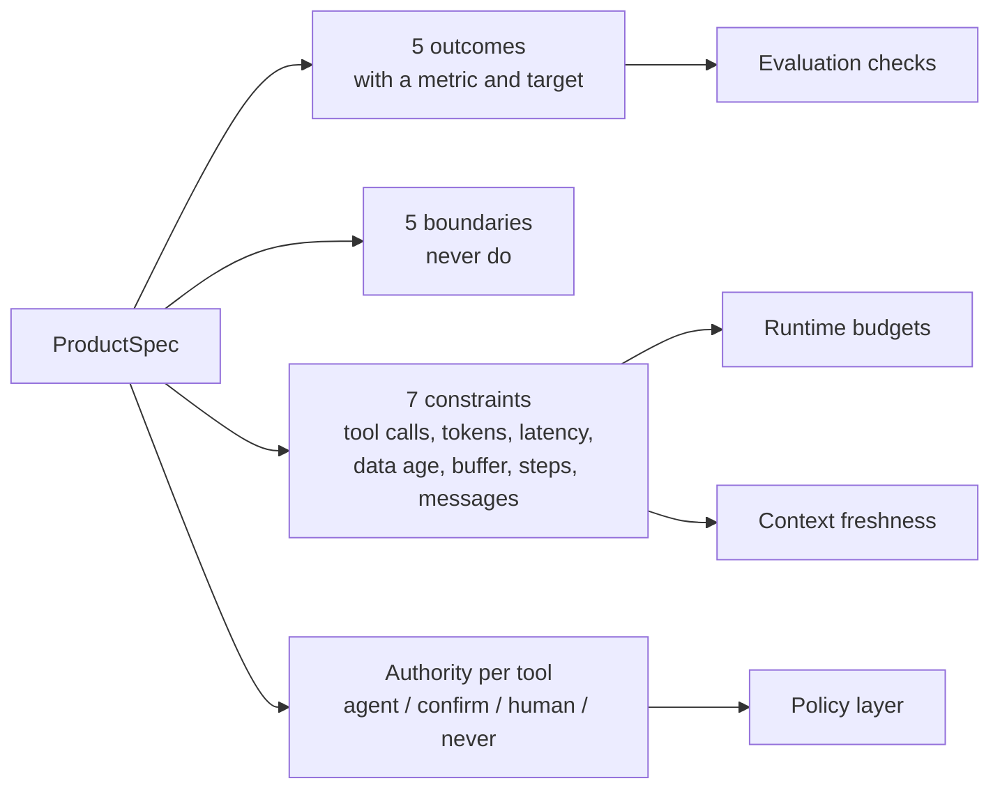

# Layer 1 - Product requirements

**Question:** what must the system achieve, what must it never do, under which limits, and who has
the authority to say yes?

## Why it matters

Most agent failures start before any code: nobody wrote down that a rebooking needs a person, or that
a gate older than five minutes cannot be trusted. If the rules live only in a prompt, nothing checks
them.

## How Harrowgate does it

The requirements are a typed object, `SPEC`, in [`harrowgate/requirements.py`](../../harrowgate/requirements.py).
Other layers read from it instead of repeating the numbers.

| Authority | Meaning | Example |
|---|---|---|
| agent | may do it alone | read a flight status |
| confirm | may do it after validation and logging | message the passenger, move a bag |
| human | a named role must approve | rebooking with a fare difference (duty manager) |
| never | outside the system | refunds |

`validate_spec(SPEC, tools)` fails if a tool has no authority rule, a rule points to a missing tool, a
human rule names no approver, or a limit is not positive. A test runs it on every push, so the tool
catalogue and the spec cannot drift apart.

## Tests

`tests/test_l01_requirements.py`: spec matches tools, missing rule detected, approver required,
positive limits, rebooking needs a human, refunds are out of scope.

## Trade-offs

A typed spec is less flexible than a document, but it can be checked. Business owners still review
the prose; engineers own the object.
