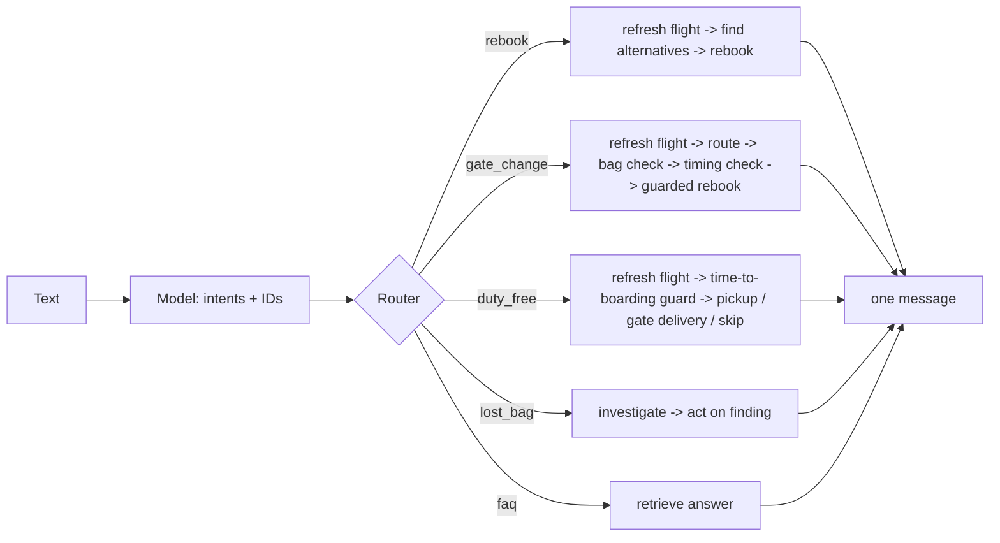

# Layer 2 - Orchestration

**Question:** who decides the order of the work: the model, or the system?

## Why it matters

Letting a model choose every next step is slow, costly and hard to test. Most airport requests follow
known paths. The order also carries business rules: a duty-free plan must use the *new* gate, and it
must check time-to-boarding before suggesting a detour.

## How Harrowgate does it

The model only turns text into intents. A deterministic router
([`harrowgate/orchestrator.py`](../../harrowgate/orchestrator.py)) maps intents to fixed workflows,
merges them in a fixed priority order, removes repeated steps and ends with one passenger message.

Priority: rebook, gate change, flight status, duty-free, lost bag, FAQ. "My gate changed and I want my
duty-free order" becomes one plan where the gate is resolved first.

**Handoffs.** When the timing check finds the passenger cannot reach the gate, the journey agent hands
off to the flight planning agent with a typed envelope (layer 9). The guarded rebooking steps then act.

`check_order(plan)` encodes the ordering rules, and a test runs it on every combination of up to three
intents.

## Tests

`tests/test_l02_orchestration.py`: gate before duty-free, no repeated steps, order independence, all
plans valid, bad plan caught, unknown intent rejected, guard runs before the duty-free choice, handoff
to flight planning when the passenger cannot make it.

## Trade-offs

Fixed workflows cannot handle a request nobody planned for. Those go to the FAQ path or a human. New
paths are added as code with tests, which is slower than editing a prompt but far safer.
