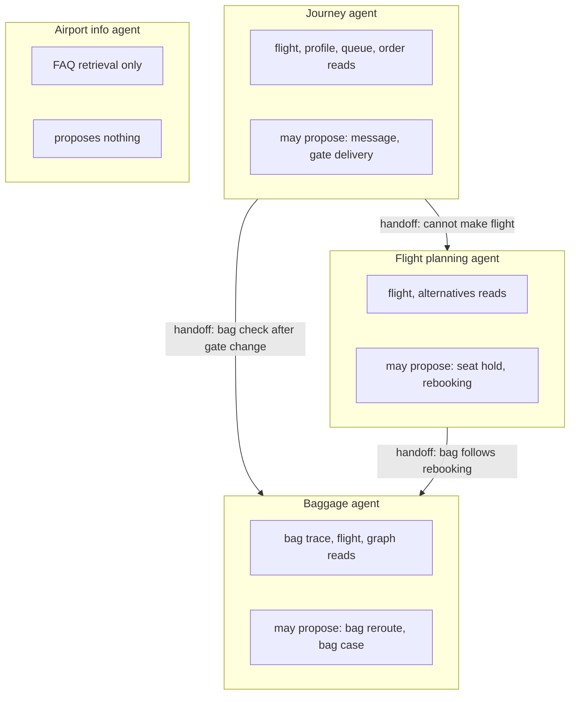

# Layer 3 - Agent boundaries

**Question:** how many agents, and where does one end and the next begin?

## Why it matters

Twenty agents with overlapping jobs hand work back and forth, repeat calls and are impossible to
debug. One giant agent holds every permission. Boundaries should follow **who owns the data and who
holds the authority**.

## How Harrowgate does it

Four agents ([`harrowgate/agents.py`](../../harrowgate/agents.py)):

Rules that keep the boundaries honest:

- Agents hold **read** tools only. The executor is the only principal with write tools.
- Route maths, fee maths and lookups are **tools or plain code**, not agents (layer 9).
- Only one place is a real model loop: the **lost-bag investigation**, because the next step depends
  on what the last scan said. It is capped at 6 steps; a bag that stays "in transit" escalates.
- Agents talk through typed handoffs, never by sharing a prompt or a conversation.

## Tests

`tests/test_l03_agents.py`: four agents, read-only tool sets, only the executor writes, the info agent
cannot propose, every write has a proposer, the investigation loop, the step limit, the escalation for
a missing bag.

## Trade-offs

Fewer agents means each one is a little broader. That is fine while each still owns one data domain.
Split an agent when two teams would own its data, not when its prompt gets long.
