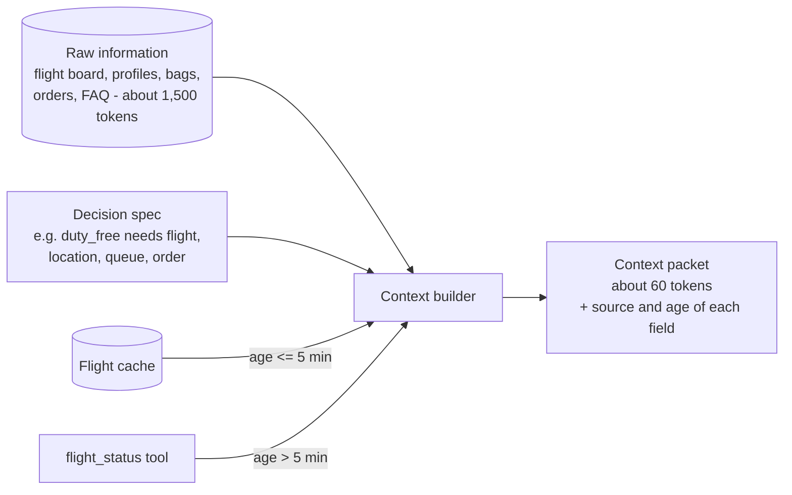

# Layer 4 - Context design

**Question:** what exactly does each decision get to see?

## Why it matters

Sending "everything" makes answers slower, costlier and less accurate, and it hides old data inside
fresh data. The classic airport failure is a gate read from a cached copy taken before the gate moved.

## How Harrowgate does it

- Each decision type declares at most four fields ([`harrowgate/context.py`](../../harrowgate/context.py)).
- Every field records where it came from and how old it is; the trace keeps that record.
- Volatile flight data older than the spec limit (5 minutes) is fetched live.
- Reads are memoised per request, so the same fact is not fetched twice.
- A passenger can only see their own orders (boundary B3).
- Preferences come from memory only if the passenger agreed (layer 5).

**Measured (synthetic suite):** packets average 57.9<!-- m:final.context.avg_packet_tokens --> tokens against
1530<!-- m:final.context.avg_raw_tokens --> for everything, a 96.2%<!-- m:final.context.reduction --> reduction. Turning the
freshness check on was the first change the learning loop released (layer 14).

## Tests

`tests/test_l04_context.py`: packet size, stale cache refetched, stale cache used when the check is
off, fresh cache trusted, small field lists, no reads of other passengers' orders, memory only with
consent.

## Trade-offs

A time-based rule cannot see a change that lands inside the window. Four scenarios (S025-S028) showed
that miss; layer 18 now adds change events, so the cache is evicted when a flight changes (released as
v4). The age limit stays as a backstop if the feed stalls. In the eight domain packs the same
context builder cuts packets to about 40-47 tokens from 420-670.
