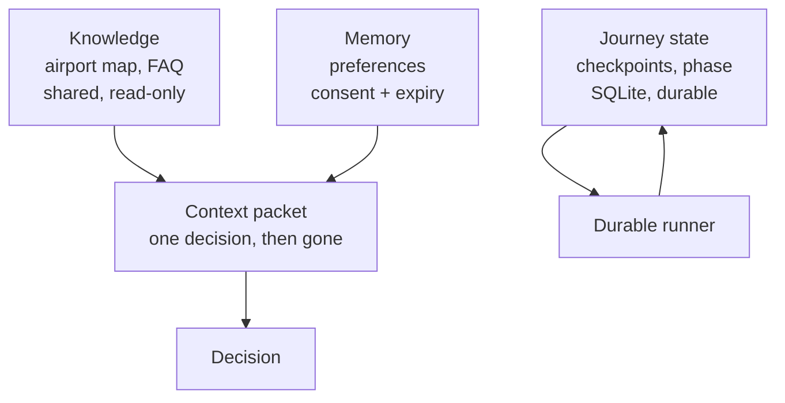

# Layer 5 - State and memory

**Question:** what does the system remember, where, and for how long?

## Why it matters

"Memory" is often one bucket. Then a preference is treated as a fact, an old gate is "remembered",
and a crash forgets which messages were already sent.

## How Harrowgate does it

Four separate places ([`harrowgate/state.py`](../../harrowgate/state.py)):

| Store | Holds | Lifetime | Writer |
|---|---|---|---|
| Knowledge | airport map, FAQ text | until republished | nobody at run time |
| Context packet | the few facts one decision needs | one decision | context builder |
| Memory | preferences (language, step-free) | 7 days by default, only with consent | the passenger |
| Journey state | run checkpoints and journey phase | the trip | the runtime |

- Memory refuses to store anything without consent, expires, and has `forget()`.
- A remembered value can never override a live fact; a test stores a fake "gate" in memory and checks
  the answer still uses the live gate.
- Journey state lives in SQLite so a new process can resume a run (layer 10).

## Tests

`tests/test_l05_state.py`: checkpoint round trip, survives a new connection, consent and expiry,
forget, journey phase, cache fetch time, memory cannot override facts.

## Trade-offs

SQLite in the container is enough for the demo. In Azure the journey state should move to a managed
database (Planned) so a new replica can resume another replica's run.
