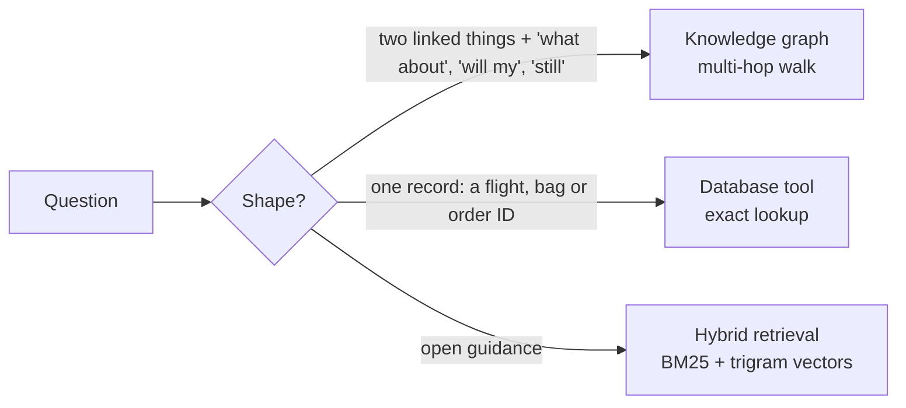
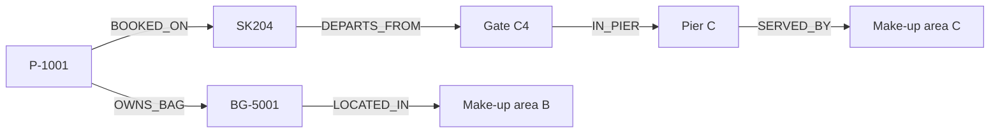

# Layer 6 - Knowledge design

**Question:** which store should answer which kind of question?

## Why it matters

Vector search is good at "find me the paragraph about liquids". It is poor at "my gate changed - is my
bag still on the right belt?", which needs a walk across linked facts: passenger -> flight -> gate ->
pier -> make-up area, and bag -> current area. Choose the store by the **shape of the question**.

## How Harrowgate does it

[`harrowgate/knowledge.py`](../../harrowgate/knowledge.py):

`gate_change_impact` walks this graph and compares the bag's area with the area that serves the new
gate. It returns `ok`, `move` (with minutes) or `too_late` (after the 25-minute bag cut-off).

The FAQ retriever mixes BM25 keyword scores with hashed character-trigram vectors, so it runs offline
without an embedding model.

**Measured (self-written labelled sets, regression checks only):** store choice right on
21<!-- m:knowledge.store_choice.correct --> of 22<!-- m:knowledge.store_choice.n --> questions; FAQ hit@1 on
17<!-- m:knowledge.faq_hit_at_1.correct --> of 18<!-- m:knowledge.faq_hit_at_1.n -->. Both misses are kept as tests.

## Tests

`tests/test_l06_knowledge.py`: graph walk, broken chain, move / too-late / same-pier impact, store
choice by shape, the known misses, sorted scores.

## Trade-offs

The question classifier is rules, so it misses words it does not know ("plane"). A small classifier
or the model could replace it; the routing contract would stay the same.
