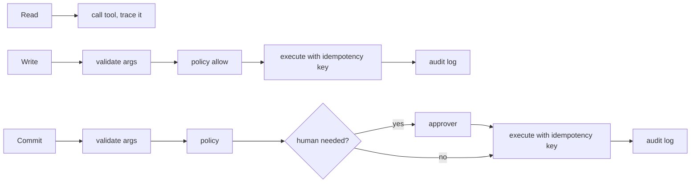

# Layer 7 - Action design

**Question:** how careful must each action be?

## Why it matters

Reading a gate is harmless. Sending a message is visible. Rebooking spends money and changes a ticket.
Treating them the same is either too slow or too dangerous.

## How Harrowgate does it

[`harrowgate/actions.py`](../../harrowgate/actions.py):

| Class | Tools | Ceremony |
|---|---|---|
| read | flight status, route, bag trace, order, alternatives, FAQ, graph | none, still traced |
| write | message, gate delivery, bag reroute, bag case, seat hold / release | validate, policy, key, audit |
| commit | rebooking | validate, policy (often a human), key, audit |

- The **executor** is the only principal that can call writes. It refuses a decision without a valid
  policy token, and tokens are bound to the exact tool and arguments.
- Idempotency key = run id + step + tool + hash of arguments. A retry or a resumed step sends the same
  key, and the tool server returns the stored result instead of acting again.
- Invalid arguments are rejected before policy is asked.

## Tests

`tests/test_l07_actions.py`: allowed write runs and is audited, refused without allow, forged token,
token bound to the call, invalid args, retry replayed, no key means double action, commit waits for a
human.

## Trade-offs

A human step makes rebooking slower. The policy pre-approves the common safe case (same fare, same
city) so people only see the cases that need judgement.
