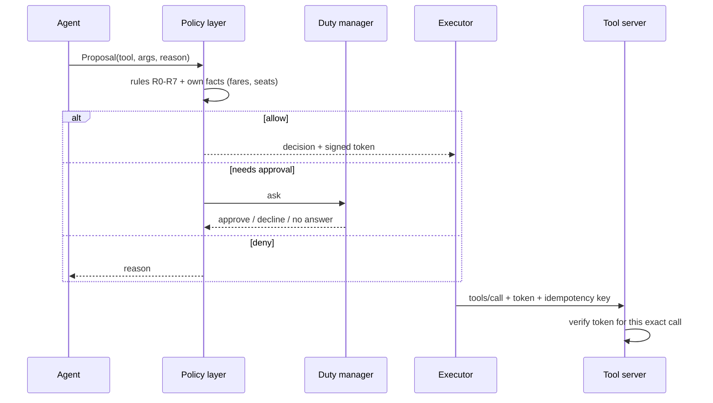

# Layer 8 - Authority design

**Question:** who is allowed to say yes?

## Why it matters

If the agent both decides and acts, one bad parse or one injected sentence can rebook a passenger.
Authority must sit **outside** the agent.

## How Harrowgate does it

[`harrowgate/policy.py`](../../harrowgate/policy.py):

| Rule | Effect |
|---|---|
| R0 | tools outside authority (refunds) or read tools are not proposals |
| R1 | each write has named proposer agents; others are denied |
| R2 | if the input guard flagged the request, bookings and seat holds are denied |
| R3 | at most 3 messages per passenger per request |
| R4 | other writes: allow after validation, with logging |
| R5 | no cabin changes; no booking on a full flight |
| R6 | same-fare rebooking is pre-approved |
| R7 | any fare difference needs the duty manager |

The policy reads fares and seat counts from the system of record. A proposal whose reason says "fare
difference is 0" still needs approval if the real difference is 120.

## Tests

`tests/test_l08_policy.py`: pre-approved same fare, fare difference to a human, decline is final,
wrong agent, untrusted input blocks bookings but not messages, no seat, cabin change, out of scope,
message cap, policy ignores agent claims, injection cannot rebook end to end.

## Trade-offs

Rules in code need a release to change. That is deliberate for money-moving actions; softer rules
(message wording) can live in configuration.
