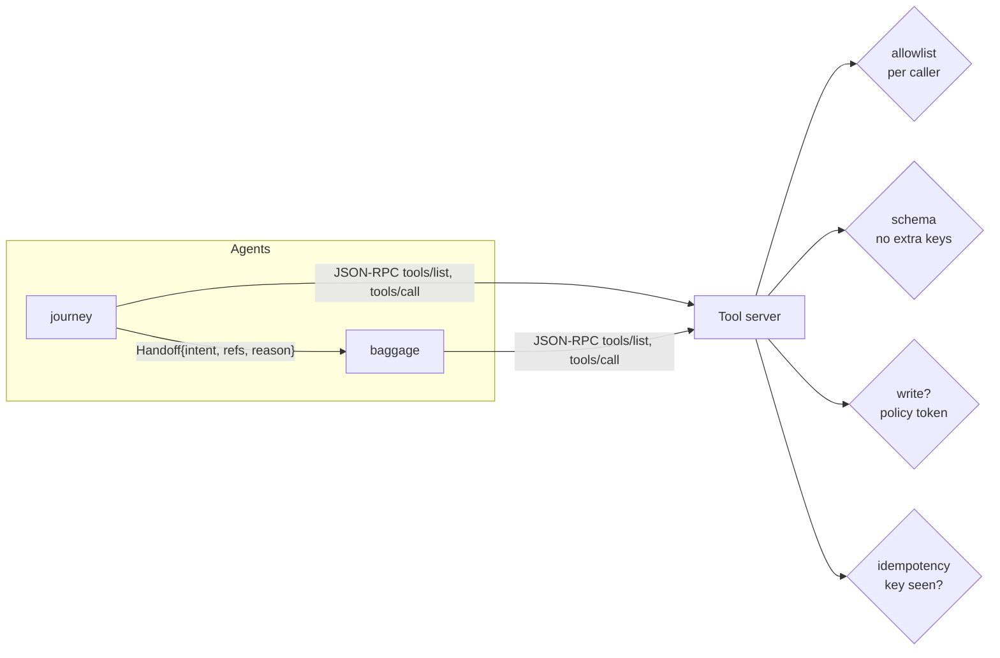

# Layer 9 - Interaction design

**Question:** for each job, should we use a database tool, plain code, retrieval or an agent?

## Why it matters

Using a model to add up walking minutes adds cost and risk for no gain. Using code to investigate a
lost bag across three systems is brittle. Pick the **cheapest mechanism that is reliably right**.

## How Harrowgate does it

[`harrowgate/interaction.py`](../../harrowgate/interaction.py), [`harrowgate/tools.py`](../../harrowgate/tools.py),
[`harrowgate/a2a.py`](../../harrowgate/a2a.py):

| Job | Mechanism | Why |
|---|---|---|
| gate, bag scan, order lookup | database tool | exact and auditable |
| ETA, safety buffer, fare difference | deterministic code | maths, no judgement |
| liquids, assistance, lounge | retrieval | answer is written policy |
| lost-bag investigation | agent loop | next step depends on the last result |

**MCP-style tool server.** JSON-RPC 2.0 with `tools/list` (each caller sees only its tools, with an
input schema and an action class) and `tools/call`. It checks the allowlist, the schema, the policy
token for writes, and idempotency keys. It can inject timeouts and lost replies for testing.

**Agent-to-agent handoff.** A typed task envelope: from, to, intent, references (not payloads), reason,
status. The receiver must accept the intent; big payloads and self-handoffs are refused.

**Route maths.** `plan_route` picks the faster security checkpoint (walk + queue). `duty_free_choice`
returns pickup, gate delivery or skip.

## Tests

`tests/test_l09_interaction.py`: per-caller tool lists, schema rejects extra keys, allowlist, write
without token, bad JSON-RPC, scripted timeout, mechanism table, faster checkpoint, duty-free branches,
handoff validation and shape.

## Trade-offs

This is MCP-*style*, not a full MCP server: no transport negotiation or resources. The method names and
schemas match, so swapping in a real MCP server changes the transport, not the agents.
