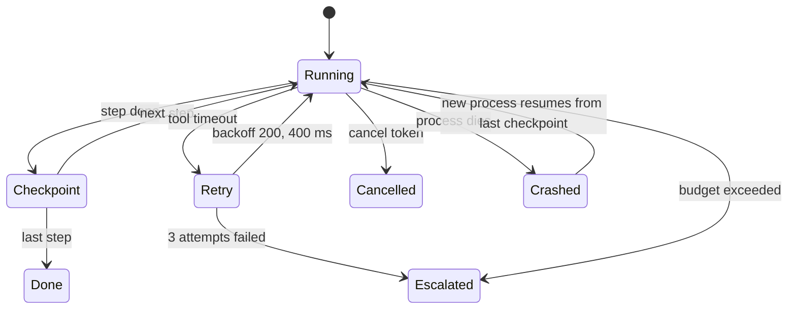

# Layer 10 - Runtime design

**Question:** what happens when a tool times out, the process crashes, or an agent loops?

## Why it matters

Agents run long, call slow systems and sometimes die halfway. Without durable execution a crash means
starting again, and starting again means repeating side effects.

## How Harrowgate does it

[`harrowgate/runtime.py`](../../harrowgate/runtime.py):

- **ToolClient**: timeout, up to 3 attempts with exponential backoff, a trace span per attempt.
  Business errors (unknown flight, too late) are not retried.
- **Budget**: 25 tool calls, 6,000 tokens, 8,000 ms simulated latency per request (from the spec).
- **DurableRunner**: saves a checkpoint after every step in SQLite. `resume()` continues from the last
  saved step. A cancel token is checked between steps.
- A crash *after* a step's side effect but *before* its checkpoint is the worst case: the step runs
  again. Layer 11 makes that safe.

## Tests

`tests/test_l10_runtime.py`: retry recovers, retries bounded, exponential backoff, no retry on
business errors, call / latency / token budgets, stable idempotency keys, crash then resume, resume of
a finished run, cancellation, cancel leaves no bag move, outage escalates.

## Trade-offs

Simulated time keeps tests fast and exact; it does not prove real network behaviour. The design maps
directly onto a durable workflow engine if one is needed later.
