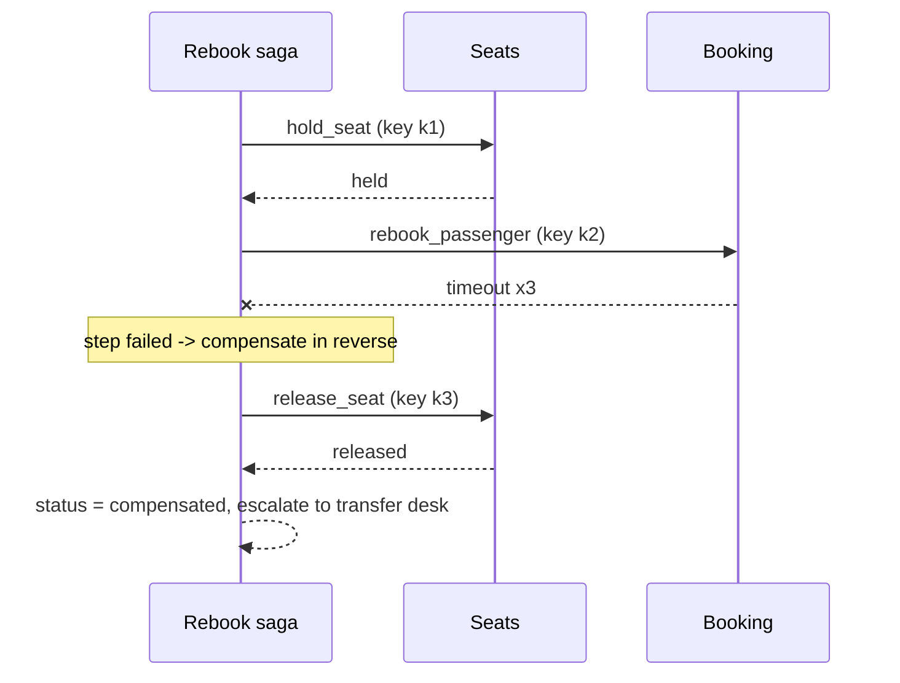

# Layer 11 - Recovery design

**Question:** how do we undo half-finished work, and make sure nothing happens twice?

## Why it matters

A rebooking touches seat inventory, the booking and the bag system. There is no single transaction
across them. And a lost reply ("did my message go out?") tempts a retry that sends it twice.

## How Harrowgate does it

[`harrowgate/saga.py`](../../harrowgate/saga.py) and the idempotency keys from layer 7.

- Each saga step can register a compensation. On failure, finished steps are undone in reverse order.
  If a compensation itself fails, the saga says so (`compensation_failed`) instead of hiding it.
- **Lost acknowledgements:** the tool did the work but the reply was lost. The retry carries the same
  key, so the server replays the stored result.
- **Crash between effect and checkpoint:** the resumed step builds the same key and is replayed.

**Measured (synthetic suite):** duplicate side effects fell from 9<!-- m:v0.duplicate_effects --> in v0 to
0<!-- m:final.duplicate_effects --> after keys were released by the learning loop.

## Tests

`tests/test_l11_recovery.py`: reverse compensation, failed compensation reported, completed saga,
booking outage releases the seat, resume with and without keys, lost reply with and without keys, gate
delivery delivered once after a crash.

## Trade-offs

Keys need storage and an expiry policy on the provider side. Some steps cannot be undone (a sent
message); those go last and are protected by keys rather than compensation.
