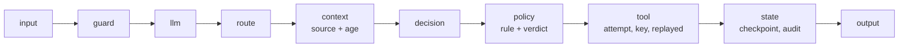

# Layer 13 - Observability

**Question:** when something goes wrong, can we see why?

## Why it matters

"The passenger went to the wrong gate" is a symptom. The cause might be stale context, a broken tool,
a policy block or a bad plan. Without a trace that records the *inputs to each decision*, every
failure looks the same.

## How Harrowgate does it

[`harrowgate/observability.py`](../../harrowgate/observability.py): one trace per request with typed
spans.

- Context spans record the flight data source (cache or live) and when it was fetched.
- Tool spans record each attempt, timeouts, the idempotency key and whether a result was replayed.
- Policy spans record the rule and verdict.
- **Privacy:** names and emails are masked; passenger IDs become keyed pseudonyms (`HARROWGATE_TRACE_KEY`,
  rotated by changing the key).

`classify_root_cause` turns a failed evaluation plus its trace into one cause:

| Cause | Signal |
|---|---|
| stale_context | wrong location and the context used data fetched before the gate changed |
| unsafe_timing | timing check failed |
| duplicate_side_effect | the same effect twice |
| unauthorized_action | a write without an allow |
| tool_failure | retries exhausted |
| budget_exceeded | a budget span |
| policy_block | an unexpected deny |
| wrong_outcome | anything else |

## Tests

`tests/test_l13_observability.py`: span order, masking, keyed pseudonyms rotate, unknown span kinds
rejected, no raw identity in an end-to-end trace, each root cause, render.

## Trade-offs

Traces stay in memory here. Exporting spans to Application Insights through OpenTelemetry is Planned;
the span shape already maps to it.
