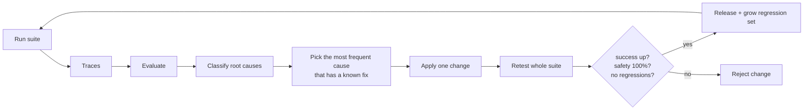

# Layer 14 - Learning design

**Question:** how does the system get better without breaking what already works?

## Why it matters

Fixing failures one by one, by feel, often breaks something else. A learning loop needs data (traces),
a judge (process evaluation), a way to group failures (root causes), and a release gate.

## How Harrowgate does it

[`harrowgate/learning.py`](../../harrowgate/learning.py):

The loop starts from v0 (no freshness check, no boarding guard, no idempotency keys) and stops when no
fixable cause is left. Causes without an automatic fix are reported for a person.

| Round | Cause fixed | Success after |
|---|---|---|
| v0 | - | 69.0%<!-- m:learning.0.success --> |
| v1 | stale context -> freshness check | 78.3%<!-- m:learning.1.success --> |
| v2 | unsafe timing -> time-to-boarding guard | 88.4%<!-- m:learning.2.success --> |
| v3 | duplicate side effects -> idempotency keys | 95.3%<!-- m:learning.3.success --> |
| v4 | stale context again (inside the age window) -> change events | 98.4%<!-- m:learning.4.success --> |

Every round was released with 0 regressions. The regression set (every scenario that ever passed) is
saved to [`data/regression_set.json`](../../data/regression_set.json) with
127<!-- m:regression_set_size --> scenarios, and a test checks it matches a fresh run. The remaining failures are
the known misses listed in the README.

A test also sabotages one fix so it breaks a passing scenario, and checks the loop refuses to release it.

## Tests

`tests/test_l14_learning.py`: fix order and final config, rising success with no regressions, no open
causes, regression set matches the file, a regressing fix is rejected, each fix maps to a real flag.

## Trade-offs

Here the "fixes" are known switches, so the loop chooses rather than invents. In production the same
gate applies to prompt, tool or code changes written by people or by an optimiser.

Stale context came back as the top cause after v3, so the loop tried the next fix for that cause
(change events, layer 18) instead of giving up. Each cause now has an ordered list of fixes.

The same loop runs on each domain pack, from 17.1%<!-- p:totals.v0_success --> with every layer off to
97.1%<!-- p:totals.success --> with them on, releasing one fix per round.
