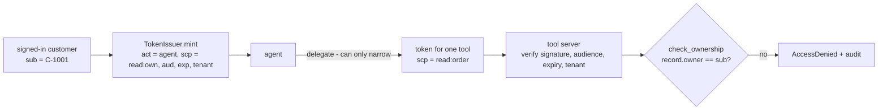

# Layer 16 - Identity and access

**Question:** on whose behalf is the agent acting, and what may it touch?

## Why it matters

An agent usually runs with a service identity that can read every customer. If it acts on that
identity alone it becomes a "confused deputy": a customer asks about someone else's account and the
agent, which is allowed to read it, happily answers. Identity has to be a chain: the person, the
agent acting for them, and the tool it calls, with permissions that only get narrower down the chain.

## How it is built

- [`harrowgate/identity.py`](../../harrowgate/identity.py): `AgentIdentity`, `TokenIssuer` (signed
  tokens with `sub`, `act`, `scp`, `aud`, `exp`, `ten` and the delegation `chain`), `delegate()` that
  refuses to widen scope, `check_ownership`.
- Every read in a domain pack passes the token and the record owner is checked at the tool server,
  not in the prompt.
- A forged or expired token, a token for another audience or another tenant, is refused.

**Measured (synthetic):** with identity off, each domain suite shows 2<!-- p:packs.retail.off.identity.cross_subject_reads --> cross-customer reads
(16<!-- p:totals.cross_reads_without_identity --> across the 8 domains). With it on: 0.

## Tests

`tests/test_l16_identity.py`: mint and verify, expiry, wrong audience, tampered signature, delegation
only narrows, cross-tenant token refused, ownership check. `tests/test_domain_packs.py`: a forged
token is refused in every pack.

## Trade-offs

Tokens here use a shared HMAC key to stay offline. A real system uses the identity provider's
signed tokens and on-behalf-of exchange; the checks stay the same.
