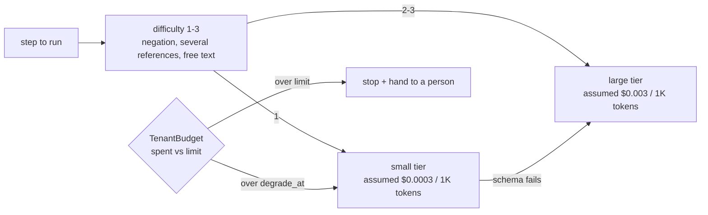

# Layer 17 - Model routing and budgets

**Question:** which model does each step need, and what stops the bill from running away?

## Why it matters

Most steps in a business workflow are easy: read a reference, fill a template. Sending them all to the
largest model makes the system slower and several times more expensive without making it more correct.
Without a budget per tenant, one busy customer or one loop can spend the month's money in an hour.

## How it is built

- [`harrowgate/routing.py`](../../harrowgate/routing.py): `difficulty()`, `Router` (small first,
  cascade to large when the answer fails its schema), `TenantBudget`, `cost_usd`.
- Prices are **assumed** round figures dated 2026-11-09 (`PRICE_AS_OF`), not quotes.
- Plain code does what code can (dates, amounts, limits); the model only reads free text.

**Measured (synthetic):** across the 8 domains, the optimised build costs 87.5%<!-- p:totals.cost_cut_min --> to
93.7%<!-- p:totals.cost_cut_max --> less per request than the unoptimised build at the same pass rate. Routing alone
accounts for a 3.2x difference in the healthcare suite. Full tables:
[optimisation and cost](../optimization-and-cost.md).

## Tests

`tests/test_l17_routing.py`: difficulty rules, cascade on schema failure, budget degrade and stop,
cost arithmetic. The routing ablation is in `tests/test_domain_packs.py`.

## Trade-offs

The simulated model is equally right on both tiers, which flatters the unoptimised build; real models
differ, so the cascade threshold must be measured on real traffic.
