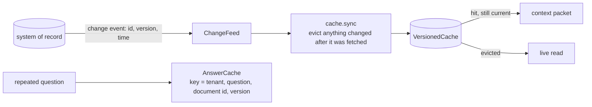

# Layer 18 - Caching and freshness

**Question:** when is a remembered answer still true?

## Why it matters

Caches make agents fast and cheap, and they also make them confidently wrong. The airport suite had
four scenarios (S025-S028) where a gate moved one minute after a three-minute-old copy was taken: a
5-minute age rule cannot see that. The fix is to listen for changes instead of guessing from age.

## How it is built

- [`harrowgate/freshness.py`](../../harrowgate/freshness.py): `ChangeEvent`, `ChangeFeed`,
  `VersionedCache` (age limit plus events; `ttl=None` means events only), `AnswerCache` keyed by the
  document version, so a policy change can never serve an old answer.
- In the airport build, `FlightCache.sync(feed)` runs before every flight read (released as **v4**).

**Measured:** airport suite v3 95.3%<!-- m:learning.3.success --> -> v4 98.4%<!-- m:learning.4.success --> (127<!-- m:learning.4.passed --> of
129<!-- m:suite.scenarios -->); all four in-window gate changes now pass. In each domain pack, change events off
gives 2 stale answers.

## Tests

`tests/test_l18_freshness.py`: eviction on event, age limit, events-only mode, answer cache misses
after a document version change, per-tenant keys. `tests/test_l12_evaluation.py` checks the four
in-window scenarios fail without change events and pass with them.

## Trade-offs

Events need a reliable feed; if the feed stalls, the age limit is still there as a backstop.
