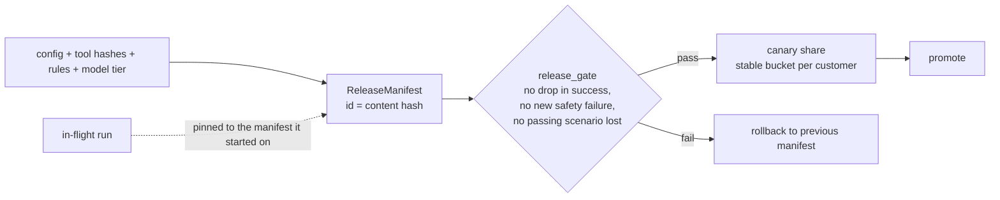

# Layer 19 - Versioning and release

**Question:** how does a change reach users without breaking what already works?

## Why it matters

An agent is prompts, tool definitions, rules, model choice and code. Changing any one of them changes
behaviour. Without a version for the whole bundle you cannot say what produced an answer, compare two
builds, or roll back.

## How it is built

- [`harrowgate/release.py`](../../harrowgate/release.py): `ReleaseManifest`, `manifest_for`,
  `canary_bucket` (same customer always lands in the same bucket), `release_gate`, `ReleaseTrack`
  (runs stay pinned; rollback is a pointer move).

**Measured (synthetic):** in all 8 domains, a candidate missing change events was promoted
(91.4% -> 97.1%) and a candidate missing idempotency keys was rolled back (success fell to
85.7% and 4 passing scenarios failed).

## Tests

`tests/test_l19_release.py`: manifest id changes with any part, stable canary buckets, gate refuses a
regression or a new safety failure, rollback, pinned in-flight runs.

## Trade-offs

The canary here is simulated on the suite. With real traffic the canary needs a minimum sample before
the gate can decide.
