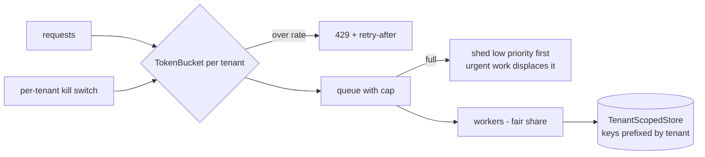

# Layer 20 - Multi-tenancy, rate limits and backpressure

**Question:** what happens when one customer organisation floods the system?

## Why it matters

A shared agent platform serves several organisations at once. Without limits per tenant, one burst
(a grocer's sale weekend) fills the queue and everyone else waits or is dropped. Without isolation,
caches, memory and audit logs can mix tenants' data.

## How it is built

- [`harrowgate/tenancy.py`](../../harrowgate/tenancy.py): `ns()`, `TokenBucket`, `Tenant` (with a
  kill switch), `simulate()` for the load test, `TenantScopedStore`.
- Cache and answer-cache keys include the tenant (layer 18).

**Measured (simulated load, retail burst first):** with fair share, every quiet tenant is fully
served and the bursting tenant is rate limited (served share 9.2%<!-- p:tenancy.fair.served_share.retail -->);
without it the burst takes 46.2%<!-- p:tenancy.unfair.served_share.retail --> of capacity and quiet tenants drop to about half.
Details: [domain packs](../domain-packs.md).

## Tests

`tests/test_l20_tenancy.py`: bucket refill, kill switch, fair vs unfair simulation, urgent work
never shed, scoped store cannot read another tenant's key.

## Trade-offs

Fair share protects neighbours but slows the bursting tenant; paid tiers would change the weights.
