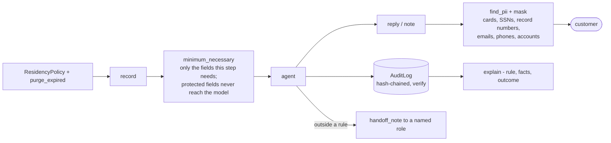

# Layer 21 - Data governance, compliance and responsible AI

**Question:** what personal data may the agent see, keep, show or send, and can we prove what it did?

## Why it matters

Agents touch regulated data: card numbers, health records, loan files. Regulators and auditors ask
the same questions everywhere: was only the necessary data used, did it stay in the right region,
was it deleted on time, who decided, and was the decision fair? Answers must come from records, not
from memory.

## How it is built

- [`harrowgate/governance.py`](../../harrowgate/governance.py): `find_pii` (with a Luhn check for
  cards), `mask`, `minimum_necessary`, `ResidencyPolicy`, `purge_expired`, `AuditLog` (each entry
  includes the hash of the one before, so editing history breaks `verify()`), `explain`,
  `handoff_note`.
- **Responsible AI:** protected fields (for example age, sex, marital status, postcode and ethnicity
  in the mortgage pack; diagnosis and date of birth in healthcare) are removed before any decision.
  A parity test changes only protected fields and checks the decision stays the same.
- **Human in the loop:** anything above a limit or outside a rule goes to a named role with a short
  hand-off note, so the person does not re-read the whole case.

**Measured (synthetic):** with governance off, each domain suite leaks PII 36<!-- p:packs.retail.off.governance.pii_leaks -->
times (288<!-- p:totals.pii_leaks_without_governance --> across 8 domains); with it on: 0<!-- p:totals.safety_incidents --> safety incidents of any kind.
Regulatory notes per domain are in [domain packs](../domain-packs.md) and the
[threat model](../threat-model.md).

## Tests

`tests/test_l21_governance.py`: PII patterns and masking, Luhn, minimum necessary, residency,
purge, audit chain tamper detection, explanation, hand-off note. `tests/test_domain_packs.py`:
decision parity on protected fields, healthcare PHI never in replies, audit verifies in every pack.

## Trade-offs

Regex detection misses unusual formats; a production system adds a classifier and data labels at the
source. The regulatory notes are design notes, not legal advice.
