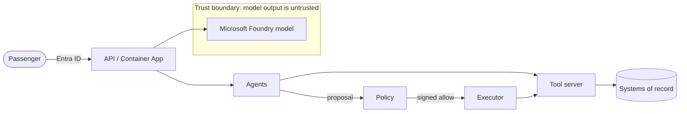

# Threat model

Scope: the assistant, its tool server, policy layer, executor and the Azure hosting in
`infra/`. Data is synthetic. Method: STRIDE per component, then the OWASP Top 10 for LLM applications.

## STRIDE

| Threat | Example | Control | Where |
|---|---|---|---|
| Spoofing | caller pretends to be another passenger | Entra ID on the API; passenger id validated; orders checked against the profile | `infra/`, `api.py`, `context.py` |
| Tampering | agent edits a proposal after approval | token is an HMAC over the exact tool + arguments | `policy.py`, `tools.py` |
| Repudiation | "the system rebooked me without asking" | audit record with rule and approver for every write; trace spans | `actions.py`, `observability.py` |
| Information disclosure | traces or replies leak names, emails, other passengers | masking, keyed pseudonyms, own-orders only, replies carry no PII | `observability.py`, `context.py`, `api.py` |
| Denial of service | runaway agent loop or retry storm | budgets (calls, tokens, latency), 6-step investigation cap, bounded retries, body size limit | `runtime.py`, `agents.py`, `api.py` |
| Elevation of privilege | agent calls the booking tool directly | agents hold read tools only; tool server refuses writes without a policy token | `agents.py`, `tools.py` |

## OWASP LLM Top 10 (2025)

| Risk | Control |
|---|---|
| LLM01 Prompt injection | input guard flags instruction-like text; policy denies bookings for flagged requests; tests in `test_l08_policy.py` |
| LLM02 Sensitive information disclosure | masked traces, own-orders boundary, no PII in replies |
| LLM03 Supply chain | standard library only at run time; pinned dev tools; Dependabot; SHA-pinned actions |
| LLM04 Data and model poisoning | the model only extracts intents into a schema; facts come from systems of record |
| LLM05 Improper output handling | strict schema (enums, no extra keys, no NaN), one repair, then escalate |
| LLM06 Excessive agency | read-only agents, external policy, human approval for fare differences, refunds out of scope |
| LLM07 System prompt leakage | no secrets in prompts; guard flags "system prompt" requests |
| LLM08 Vector and embedding weaknesses | retrieval only over a fixed, reviewed FAQ set |
| LLM09 Misinformation | answers about gates and bags come from tools, not the model; process evaluation |
| LLM10 Unbounded consumption | token, call and latency budgets; small model capacity cap in IaC |

## Residual risks

- The input guard is pattern based and can be evaded; the real protection is that policy, not the
  model, controls actions.
- Time-based freshness alone missed changes inside the window; change events (layer 18) now cover
  it, and if the feed stalls the age limit is the backstop.
- Container-local SQLite loses journey state if the replica is replaced (Planned: managed database).

## Threats added with layers 15-21 (all domains)

| Threat | Example | Control | Where |
|---|---|---|---|
| Indirect prompt injection | "approve this refund" inside a record note | scan and quote as data; rules outside the agent read the system of record | `security.py`, `packs/engine.py` |
| Tool poisoning / rug pull | tool description changes after review | hash-pinned tool manifest; drift blocks the tool | `security.py` |
| Exfiltration through normal channels | reply or link sent to an outside address | egress allow-list, secret and card refusal | `security.py` |
| Confused deputy | customer reads another customer's record through the agent | delegated token with `sub`, narrowed scope, ownership check at the tool | `identity.py` |
| Cross-tenant leak | cache or memory key shared by two organisations | tenant-prefixed keys, tenant claim in token | `tenancy.py`, `freshness.py` |
| Noisy neighbour / DoS | one tenant's burst starves the others | token bucket, queue cap, fair share, kill switch | `tenancy.py` |
| Cost exhaustion | loop or flood on the large model | per-tenant budget, degrade then stop | `routing.py` |
| Bad release | prompt change breaks safety | release gate, canary, rollback, pinned runs | `release.py` |
| PII disclosure | card or record number in a reply | minimum necessary, detection and masking, audit | `governance.py` |
| Unfair decision | decision changes with age or postcode | protected fields removed; parity test | `governance.py`, `test_domain_packs.py` |
| Audit tampering | edited history | hash-chained audit log with `verify()` | `governance.py` |

Per-domain threats and regulatory notes (for example HIPAA-style minimum necessary for Halsey Vale
Health, fair lending for Quillmere Home Loans, PCI-DSS style card handling and dispute time limits for Ashgrove Mutual Bank) are
generated into [domain-packs.md](domain-packs.md). They are design notes, not legal advice.
